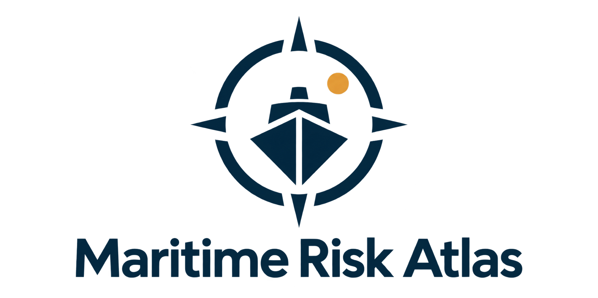

# Maritime Risk Atlas

Plateforme d’analyse du risque de piraterie maritime combinant données historiques, indicateurs socio-économiques et machine learning.



## Organisation

- `apps/web` : interface React, carte et graphiques.
- `apps/api` : API Express et préparation des points d’analyse.
- `services/ml` : données CSV historiques, entraînement et API FastAPI.
- `docs` : architecture, méthode et feuille de route.
- `infrastructure` : futurs fichiers de déploiement.

## Installation et lancement

Node.js et npm sont nécessaires pour les applications JavaScript. Depuis la racine :

```sh
npm install
cp apps/web/.env.example apps/web/.env
# Renseigner VITE_MAP_STYLE_URL dans apps/web/.env
npm run dev:web
```

Dans un autre terminal :

```sh
npm run dev:api
```

Pour le service ML, créer un environnement Python, installer `requirements.txt`, puis exécuter l’entraînement depuis `services/ml`. Le modèle entraîné n’est pas fourni. L’entraînement peut être coûteux.

```sh
cd services/ml
python -m venv .venv
. .venv/bin/activate
pip install -r requirements.txt
python train.py
uvicorn serve_fastapi:app --host 127.0.0.1 --port 8080
```

Les services existants utilisent les ports 5173, 3000 et 8080. Leur configuration sera centralisée lors de la refonte.

## Limites actuelles

L’interface conserve encore le comportement du prototype : segments directs entre points, sans évitement des terres. Le modèle estime une catégorie d’issue parmi les incidents historiques, pas la probabilité d’une attaque pendant un voyage. Voir `docs/ROADMAP.md` avant toute interprétation des scores.

## Origine

Ce projet prolonge le prototype collectif OnePirate. Les contributions à la refonte seront documentées séparément. Le monorepo démarre avec un nouvel historique Git ; les anciens historiques ont été supprimés à la demande du propriétaire.

## Conventions

Voir [CONTRIBUTING.md](CONTRIBUTING.md) pour les règles de structure et [docs/ARCHITECTURE.md](docs/ARCHITECTURE.md) pour les responsabilités des composants.
